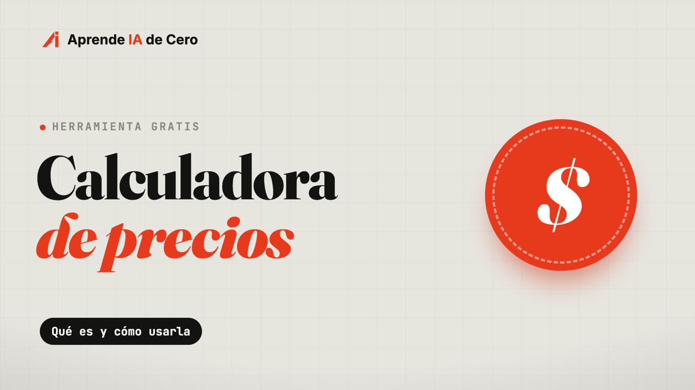

# Calculadora de precios

**¿Cuánto le cobro a mi cliente?** Una herramienta gratis de [Aprende IA de Cero](https://aprendeiadecero.com) para quien construye páginas, apps o automatizaciones y se las cobra a un negocio.

**Úsala aquí:** https://calculadora.aprendeiadecero.com — gratis, sin crear cuenta, en el celular o la computadora.

## Qué hace

1. **Te dice cuánto cobrar.** Respondes 6 preguntas: el país del cliente, qué le vas a construir, qué más lleva, la mensualidad, cómo te va a pagar y cuánto le ayuda al negocio. Te da el precio por construirlo y el de la mensualidad, con un medidor de buen precio y de dónde sale cada número.
2. **Te arma los documentos para el cliente**, con los datos escritos una sola vez:
   - **Cotización:** qué incluye, qué no, el precio y los pagos.
   - **Contrato:** ya escrito en palabras sencillas, editable y descargable en PDF.
   - **Factura** (cuenta de cobro): una por cada pago, con número automático.

## Cómo está hecha

- Una sola página (`index.html`), sin servidor ni IA por dentro: todo se calcula en el navegador.
- Tus datos se guardan solo en tu navegador.
- Tarifas según el país del cliente (Banco Mundial y Oficina de Estadísticas Laborales de EE. UU.) y los métodos de pago de cada país con sus comisiones.

> Es una guía: el contrato no reemplaza a un abogado, y si en tu país es obligatoria la factura electrónica, emítela también en el sistema oficial.
